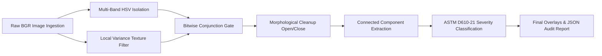

# RustScan Industrial: Automated Surface Corrosion Analysis System

[](https://en.cppreference.com/w/cpp/17)
[](https://opencv.org/)
[](https://www.astm.org/d0610-08r19.html)
[](#system-architecture)

**RustScan Industrial** is an automated, edge-deployable non-destructive evaluation (NDE) system designed for quantitative corrosion assessment on structural metals, pipelines, maritime vessels, and civil infrastructure.

Built in native **C++17** and **OpenCV**, RustScan eliminates the latency, security vulnerabilities, and subscription bloat of Python/cloud-reliant systems. It ingests high-resolution surface imagery or video streams, extracts corrosion geometries using multi-spectrum colorimetry and texture variance filtering, and computes audit-compliant **ASTM D610-21** severity grades in under **15 milliseconds**.

---

## System Architecture

RustScan operates as a self-contained edge system. An embedded high-concurrency C++ HTTP server communicates directly with in-memory OpenCV matrix buffers, serving an enterprise web workstation with zero external dependencies (no Node.js, no Python, no Docker required for runtime).

```mermaid
graph TD
    subgraph Client Layer [Frontend Presentation Layer - Browser / Tablet]
        UI[Minimalist Industrial Dashboard]
        Slider[Interactive Split Inspection Canvas]
        Gauges[ASTM D610 Severity & Metrics Matrix]
        Tuner[Real-Time CV Parameter Tuner]
    end

    subgraph Server Layer [C++17 Native Server - apps/server_main.cpp]
        HTTP[cpp-httplib Multi-threaded Server]
        Router[REST API Router: /api/inspect, /api/sample]
        BufferMgr[In-Memory Buffer & Base64 Streaming]
    end

    subgraph Core Engine [Computer Vision Core - librustcore.a]
        HSV[Multi-Band HSV Colorimetry Gate]
        Tex[Local Standard Deviation Texture Filter]
        Morph[Dual-Kernel Morphological Refinement]
        CCA[Connected Component Labeling & Spatial Metrics]
        ASTM[ASTM D610-21 Standard Grading Engine]
        VLM[Optional Ollama Local Vision LLM Client]
    end

    UI -->|Image Upload / Preset Trigger| HTTP
    HTTP --> Router
    Router --> BufferMgr
    BufferMgr --> Core Engine
    HSV --> Tex
    Tex --> Morph
    Morph --> CCA
    CCA --> ASTM
    CCA -.->|Optional Verification| VLM
    ASTM --> BufferMgr
    BufferMgr -->|JSON Metrics + Base64 Overlays| UI
```

---

## Computer Vision Pipeline Workflow

Unlike naive thresholding models that confuse red/orange paint, rust patina, or wood with corrosion, RustScan executes a deterministic 5-stage physical filter pipeline:



### Detailed Pipeline Breakdown:

1. **Multi-Band HSV Colorimetric Gate (`src/segmenter.cpp`)**:
   Iron oxides (Hematite $\text{Fe}_2\text{O}_3$, Goethite $\text{FeO(OH)}$, Magnetite $\text{Fe}_3\text{O}_4$) exhibit narrow hue bands in the $0^\circ - 25^\circ$ range, with wraparound red tones at $170^\circ - 179^\circ$. The detector isolates rust chrominance while rejecting non-metallic backgrounds.

2. **Local Standard Deviation Texture Filter**:
   Corrosion physically pits and roughens metal surfaces. Smooth orange primer or reflective yellow coatings pass color gates but have near-zero local variance. RustScan computes:
   $$\sigma(x,y) = \sqrt{\mathbb{E}[I^2] - (\mathbb{E}[I])^2}$$
   using box-filtering over a local window. Pixels with $\sigma < \tau_{texture}$ are rejected as smooth paint.

3. **Dual-Kernel Morphological Structuring**:
   * **Opening ($\text{MORPH\_OPEN}$)**: Removes random camera sensor speckle, thermal noise, and minor surface dust.
   * **Closing ($\text{MORPH\_CLOSE}$)**: Bridges microscopic micro-fissures and fills internal voids in contiguous rust blisters.

4. **Connected Component Analysis (`cv::connectedComponentsWithStats`)**:
   Labels distinct defect clusters, calculates cluster surface area, eliminates micro-particles under `minArea`, and evaluates spatial topology (e.g., concentrated patches vs. scattered pitting).

5. **ASTM D610-21 Severity Standardization (`src/severity.cpp`)**:
   Surface rust percentage is mapped to the standard industrial rating scale:

| Rust Percentage Range | ASTM D610 Grade | Industrial Interpretation | Action Required |
| :--- | :---: | :--- | :--- |
| $\le 0.01\%$ | **Grade 10** | Pristine / No Rust | Normal inspection interval |
| $0.01\% - 0.03\%$ | **Grade 9** | Minute pinpoint rust | Preventive monitoring |
| $0.03\% - 0.1\%$ | **Grade 8** | Spot rust | Surface touch-up |
| $0.1\% - 0.3\%$ | **Grade 7** | Moderate spot corrosion | Remedial coating |
| $0.3\% - 1.0\%$ | **Grade 6** | Pitting initiation | Surface blast & recoat |
| $1.0\% - 3.0\%$ | **Grade 5** | Widespread light corrosion | Scheduled maintenance |
| $3.0\% - 10.0\%$ | **Grade 4** | Concentrated patch degradation | Structural inspection |
| $10.0\% - 16.0\%$ | **Grade 3** | Severe delamination | Urgent repair |
| $16.0\% - 33.0\%$ | **Grade 2** | Deep metal loss | Structural de-rating |
| $33.0\% - 50.0\%$ | **Grade 1** | Critical failure risk | Immediate replacement |
| $> 50.0\%$ | **Grade 0** | Total structural degradation | Condemned |

---

## Tech Stack Specifications

| Component | Technology | Rationale |
| :--- | :--- | :--- |
| **Core Detection Engine** | C++17, OpenCV 5.0 | Sub-15ms deterministic processing, low memory footprint, bare-metal efficiency |
| **Embedded Web Server** | `cpp-httplib` (single header) | Eliminates Python/Node runtime overhead; self-contained in a single binary |
| **Data Serialization** | `nlohmann/json` (v3.11) | Type-safe, standards-compliant JSON serialization for REST API transactions |
| **Frontend UI** | HTML5, Vanilla CSS3, ES6 JS | Clean, minimalistic, zero-dependency interface; sub-millisecond DOM render |
| **Multithreading** | C++ Standard `std::thread`, Thread Pool | Concurrent multi-core video frame analysis and batch specimen throughput |
| **Optional VLM Verification**| Ollama REST API (`moondream`, `llava`) | Air-gapped natural language verification on edge devices without cloud telemetry |

---

## Business Value & Commercial Strategy

### 1. The Problem in Industry Today
* **Subjective Visual Inspection**: Human inspectors manually glance at bridges, oil storage tanks, ships, and pipelines with paper reference sheets. Two inspectors inspecting the same beam frequently differ by 2–3 ASTM grades.
* **Prohibitive Manual Costs**: High-risk inspections (climbing offshore rigs, chemical towers, bridge trusses) require expensive scaffolding, certified rope-access technicians, and slow turnaround.
* **Audit Liability**: Insurance carriers and regulatory bodies (DOT, IMO, OSHA) require verifiable, time-stamped proof of surface integrity.

### 2. The Solution & ROI
RustScan transforms subjective human estimates into **repeatable, mathematically certified ASTM D610 inspection data**.
* **$10\times$ Inspection Speed**: Ingests hundreds of aerial drone photos or continuous video frames per second.
* **Audit Trail**: Produces automated, tamper-proof JSON records, annotated overlays, and PDF/HTML audit logs.
* **Predictive Maintenance**: Tracks corrosion growth rates over time, preventing catastrophic pipeline leaks or structural bridge failures.

### 3. Target Customer Profiles (ICPs)
1. **Oil & Gas / Chemical Refineries**: Above-ground storage tanks, pipe racks, pressure vessel outer walls.
2. **Maritime & Offshore Shipping**: Ballast tanks, cargo holds, ship hulls, offshore drilling platforms.
3. **Civil Infrastructure & DOTs**: Steel girder bridges, highway overpasses, rail trusses.
4. **Protective Coatings Contractors**: Surface preparation validation before applying industrial paints and epoxy.

### 4. Commercial Monetization Models
* **Tier 1: Edge Appliance Hardware License**: Fixed one-time or annual license fee per ruggedized inspection tablet or drone payload unit ($4,000 – $12,000/device/year).
* **Tier 2: Enterprise Inspection SaaS**: Centralized dashboard for asset managers with cloud report aggregation, fleet-wide corrosion tracking, and regulatory compliance export ($500 – $2,500/month/facility).
* **Tier 3: OEM Embedded Integration API**: Direct C++ library licensing for drone manufacturers (Skydio, DJI Enterprise) and crawler robot developers.

---

## Step-by-Step Build & Quick Start

### 1. Prerequisites (macOS)
```bash
brew install cmake opencv
```

### 2. Build the System
```bash
cd rustscan
cmake -B build -S .
cmake --build build -j
ctest --test-dir build
```

### 3. Launch the Live Workstation
```bash
./build/rust_server --port 8765
```
Open your browser to: **`http://localhost:8765`**

### 4. CLI Batch Processing & Automated Reporting
```bash
# Process directory of images against ground truth and produce an HTML audit report:
./build/rust_batch --images data/test/images --gt data/test/masks --csv out.csv --overlays ov --report report.html --bench

# Real-time webcam or video inspection:
./build/rust_video --src 0 --live
```

---

## REST API Documentation

### `POST /api/inspect`
Executes real-time segmentation and ASTM severity grading on an uploaded image.

* **Content-Type**: `multipart/form-data`
* **Form Parameters**:
  * `image` *(binary)*: Target JPEG, PNG, or BMP image file.
  * `texMin` *(float, optional, default: 3.0)*: Local standard deviation texture threshold.
  * `minArea` *(int, optional, default: 30)*: Minimum defect pixel area.
  * `hHigh` *(int, optional, default: 25)*: Upper limit of iron oxide primary hue.
* **Response Sample (JSON)**:
  ```json
  {
    "ok": true,
    "latencyMs": 11.2,
    "width": 640,
    "height": 480,
    "assessment": {
      "grade": 4,
      "gradeDescription": "heavy",
      "percent": 3.98,
      "regions": 43,
      "largestShare": 0.065,
      "color": "orange-brown",
      "pattern": "scattered spots (possible pitting)",
      "summary": "heavy corrosion: 3.98% of the surface in 43 region(s)..."
    },
    "images": {
      "original": "data:image/jpeg;base64,...",
      "overlay": "data:image/jpeg;base64,...",
      "mask": "data:image/png;base64,..."
    }
  }
  ```
