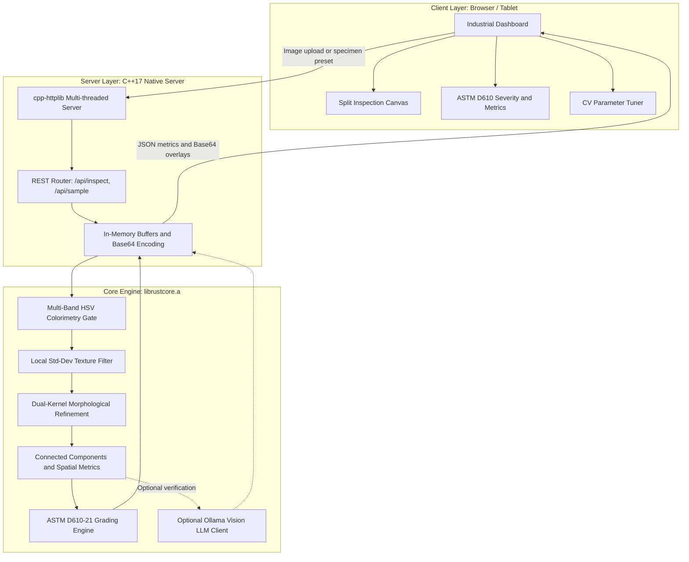
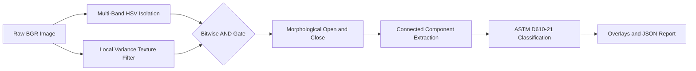
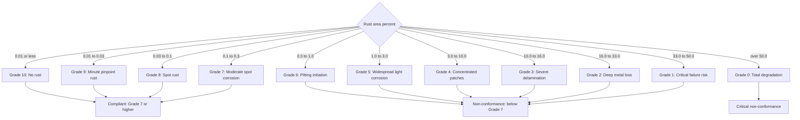
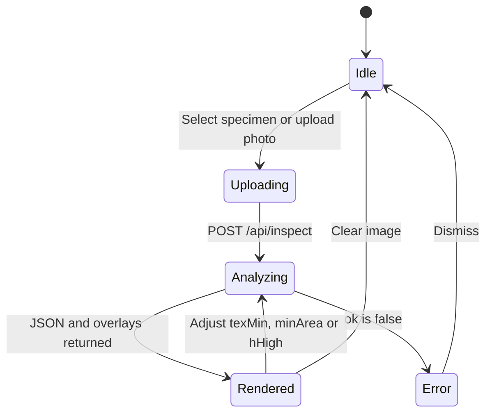
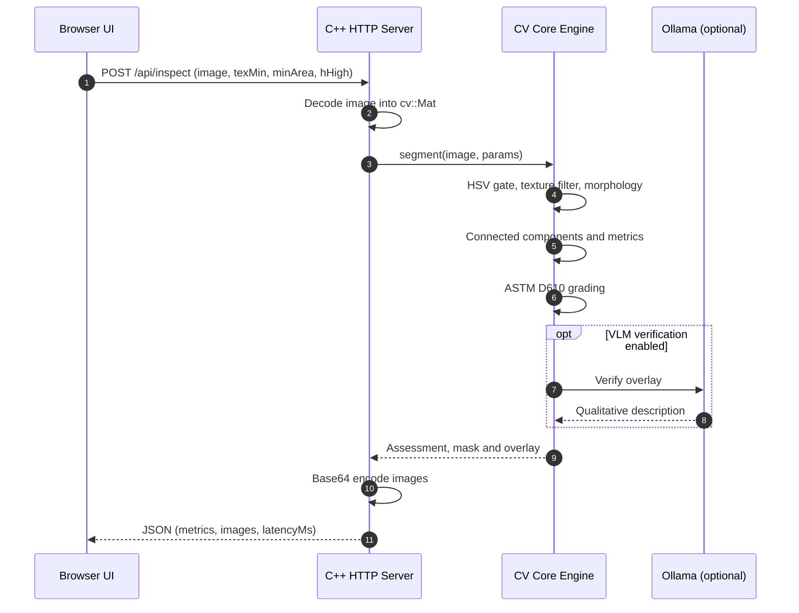

# Rusteze: Automated Surface Corrosion Analysis System

[](https://en.cppreference.com/w/cpp/17)
[](https://opencv.org/)
[](https://www.astm.org/d0610-08r19.html)
[](#system-architecture)
[](#)

**Rusteze** is an automated, edge-deployable non-destructive evaluation (NDE) tool for quantitative corrosion assessment on structural metals, pipelines, maritime vessels and civil infrastructure.

Built in native **C++17** with **OpenCV**, Rusteze avoids the latency and cloud dependence of Python-based pipelines. It ingests surface imagery or video frames, extracts corrosion regions using HSV colorimetry and a texture-variance filter, and computes **ASTM D610-21** severity grades in roughly **10–25 milliseconds** per image on commodity hardware.

---

## Table of Contents

- [System Architecture](#system-architecture)
- [Computer Vision Pipeline](#computer-vision-pipeline)
- [ASTM D610 Grading Logic](#astm-d610-grading-logic)
- [Web Workstation (UI)](#web-workstation-ui)
- [Request Lifecycle](#request-lifecycle)
- [Tech Stack](#tech-stack)
- [Quick Start](#quick-start)
- [REST API](#rest-api)
- [Known Limitations](#known-limitations)
- [Business Value](#business-value--commercial-strategy)

---

## System Architecture

Rusteze runs as a self-contained edge system. An embedded multi-threaded C++ HTTP server talks directly to in-memory OpenCV buffers and serves the web workstation. No Node.js, Python or Docker is needed at runtime. The only external library dependencies are OpenCV and two header-only libraries (`cpp-httplib`, `nlohmann/json`).



---

## Computer Vision Pipeline

Unlike naive thresholding, which confuses red or orange paint with corrosion, Rusteze runs a deterministic multi-stage filter pipeline.



### Stage Breakdown

1. **Multi-band HSV colorimetric gate** (`src/segmenter.cpp`)
   Iron oxides (hematite Fe2O3, goethite FeO(OH), magnetite Fe3O4) fall in a narrow hue band of roughly 0°–25° (OpenCV hue units, 0–179), with wraparound red tones near 170°–179°. This gate isolates rust-like chrominance and rejects most non-metallic backgrounds.

2. **Local standard deviation texture filter**
   Corroded metal is pitted and rough, while smooth primer or coatings pass the color gate but have near-zero local variance. For each pixel, the filter computes:

   ```text
   sigma(x, y) = sqrt( E[I^2] - (E[I])^2 )
   ```

   using a box filter over a local window. Pixels with `sigma < texMin` are rejected as smooth paint.

3. **Dual-kernel morphological refinement**
   - `MORPH_OPEN` removes sensor speckle, noise and dust.
   - `MORPH_CLOSE` bridges micro-fissures and fills voids inside contiguous rust blisters.

4. **Connected component analysis** (`cv::connectedComponentsWithStats`)
   Labels distinct defect clusters, computes cluster areas, drops particles smaller than `minArea`, and classifies spatial topology (concentrated patch vs. scattered pitting).

5. **ASTM D610-21 severity grading** (`src/severity.cpp`)
   The rusted surface percentage is mapped to the standard 0–10 scale (below).

---

## ASTM D610 Grading Logic



| Rust Percentage Range | ASTM D610 Grade | Interpretation | Action Required |
| :--- | :---: | :--- | :--- |
| ≤ 0.01% | **10** | Pristine / no rust | Normal inspection interval |
| 0.01% – 0.03% | **9** | Minute pinpoint rust | Preventive monitoring |
| 0.03% – 0.1% | **8** | Spot rust | Surface touch-up |
| 0.1% – 0.3% | **7** | Moderate spot corrosion | Remedial coating |
| 0.3% – 1.0% | **6** | Pitting initiation | Surface blast and recoat |
| 1.0% – 3.0% | **5** | Widespread light corrosion | Scheduled maintenance |
| 3.0% – 10.0% | **4** | Concentrated patch degradation | Structural inspection |
| 10.0% – 16.0% | **3** | Severe delamination | Urgent repair |
| 16.0% – 33.0% | **2** | Deep metal loss | Structural de-rating |
| 33.0% – 50.0% | **1** | Critical failure risk | Immediate replacement |
| > 50.0% | **0** | Total structural degradation | Condemned |

The default **compliance threshold** in the UI is **ASTM Grade ≥ 7**.

---

## Web Workstation (UI)

The dashboard is served directly by the C++ server at `http://localhost:8765`.

**Header:** engine status indicator, live latency readout and the active standard (ASTM D610).

**Standard specimens:** one-click presets for `Clean Steel Pipe`, `Localized Pitting`, `Severe Flange Corrosion` and `Structural I-Beam`, plus an **Upload Inspection Photo** button.

**Viewer modes:** `Split View` (draggable slider), `Side-by-Side`, `Annotated Overlay`, `Binary Defect Mask` and `Original Image`.

**ASTM D610-21 evaluation panel:**

| Metric | Description |
| :--- | :--- |
| Grade badge | 0–10 grade with conformance label (for example, *Critical Non-Conformance*) |
| Corrosion Area | Percentage of the surface classified as corroded |
| Disjoint Defects | Number of connected defect regions |
| Dominant Cluster | Share of corrosion contained in the largest region |
| CV Execution | Engine processing time in ms |
| Dominant Oxide Tone | Dominant color class, for example `orange-brown` |
| Morphology Pattern | For example `concentrated patch` or `scattered spots (possible pitting)` |
| Compliance Threshold | Minimum passing grade (default Grade ≥ 7) |

**Qualitative AI verification (optional):** a local vision-language model via Ollama. If the model is not installed, the panel shows a standby message. To enable it:

```bash
ollama pull moondream
./start.sh
```



---

## Request Lifecycle



---

## Tech Stack

| Component | Technology | Rationale |
| :--- | :--- | :--- |
| Core detection engine | C++17, OpenCV | Low-latency deterministic processing, small memory footprint |
| Embedded web server | `cpp-httplib` (single header) | Self-contained in one binary, no separate web runtime |
| Serialization | `nlohmann/json` (v3.11) | Type-safe JSON for REST transactions |
| Frontend | HTML5, CSS3, ES6 JavaScript | Lightweight, framework-free interface |
| Concurrency | `std::thread`, thread pool | Parallel frame analysis and batch throughput |
| Optional VLM | Ollama REST API (`moondream`, `llava`) | Local verification with no cloud telemetry |

---

## Quick Start

### 1. Prerequisites (macOS)

```bash
brew install cmake opencv
```

### 2. Build

```bash
cd rusteze
cmake -B build -S .
cmake --build build -j
ctest --test-dir build
```

### 3. Launch the workstation

```bash
./build/rust_server --port 8765
```

Open **http://localhost:8765** in your browser.

### 4. CLI batch processing and reporting

```bash
# Evaluate a directory of images against ground-truth masks and produce an HTML report
./build/rust_batch --images data/test/images --gt data/test/masks \
    --csv out.csv --overlays ov --report report.html --bench

# Real-time webcam or video inspection
./build/rust_video --src 0 --live
```

---

## REST API

### `POST /api/inspect`

Runs segmentation and ASTM severity grading on an uploaded image.

- **Content-Type:** `multipart/form-data`

| Field | Type | Default | Description |
| :--- | :--- | :---: | :--- |
| `image` | binary | required | JPEG, PNG or BMP image |
| `texMin` | float | `3.0` | Local standard deviation texture threshold |
| `minArea` | int | `30` | Minimum defect area in pixels |
| `hHigh` | int | `25` | Upper limit of the primary iron-oxide hue |

**Example request**

```bash
curl -X POST http://localhost:8765/api/inspect \
  -F "image=@pipe.jpg" \
  -F "texMin=3.0" \
  -F "minArea=30"
```

**Example response**

```json
{
  "ok": true,
  "latencyMs": 11.2,
  "width": 640,
  "height": 480,
  "assessment": {
    "grade": 4,
    "gradeDescription": "heavy",
    "percent": 3.98,
    "regions": 43,
    "largestShare": 0.065,
    "color": "orange-brown",
    "pattern": "scattered spots (possible pitting)",
    "summary": "heavy corrosion: 3.98% of the surface in 43 region(s)..."
  },
  "images": {
    "original": "data:image/jpeg;base64,...",
    "overlay": "data:image/jpeg;base64,...",
    "mask": "data:image/png;base64,..."
  }
}
```

### `GET /api/sample`

Returns one of the built-in standard specimens for demo and testing.

---

## Known Limitations

- **Color-based detection:** brightly painted red or orange surfaces can still be flagged if their texture variance exceeds `texMin`. Raise `texMin` or tighten `hHigh` for painted assets.
- **Lighting sensitivity:** strong shadows or specular glare can shift HSV values and affect the area percentage.
- **2D estimate only:** the grade is based on projected image area, not measured metal loss or depth.
- **Not a certified inspection:** results should be validated by a qualified inspector before any maintenance or safety decision.

---

## Business Value & Commercial Strategy

### The problem

- **Subjective visual inspection:** two inspectors looking at the same structure can differ by 2–3 ASTM grades.
- **High manual cost:** inspecting rigs, towers and bridge trusses needs scaffolding, rope-access technicians and long turnaround.
- **Audit requirements:** insurers and regulators expect documented, time-stamped evidence of surface condition.

### The solution

Rusteze turns subjective estimates into **repeatable, quantitative ASTM D610 data**:

- **Faster inspection:** batch-process large sets of drone photos or video frames.
- **Audit trail:** timestamped JSON records, annotated overlays and HTML reports.
- **Trend tracking:** compare corrosion over time to support predictive maintenance.

### Target customers

1. **Oil and gas / chemical:** storage tanks, pipe racks, pressure vessel exteriors.
2. **Maritime and offshore:** ballast tanks, cargo holds, hulls, platforms.
3. **Civil infrastructure:** steel girder bridges, overpasses, rail trusses.
4. **Coatings contractors:** surface-preparation validation before recoating.

### Monetization models

| Tier | Model | Indicative pricing |
| :--- | :--- | :--- |
| 1 | Edge appliance license (per inspection tablet or drone payload) | $4,000 – $12,000 / device / year |
| 2 | Enterprise inspection SaaS (fleet tracking, report aggregation) | $500 – $2,500 / month / facility |
| 3 | OEM embedded C++ library for drone and crawler vendors | Custom |

---

## License

Add your license here (for example, MIT).
